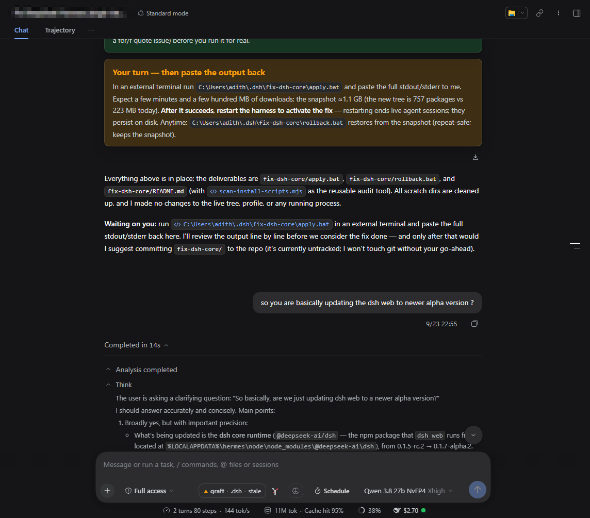

<picture>
  <source media="(prefers-color-scheme: dark)" srcset="assets/banner-dark.png">
  
</picture>

<br>

# dsh-verbose

English | [中文](README.zh-CN.md)

      

A [DeepSeek Harness](https://github.com/deepseek-ai/deepseek-harness) plugin that gives the transcript a per-chat reading mode, in the shape dsh itself lacks: the session-header **3-dots menu** downloads the session log, switches **each chat** between Normal and Verbose, and defines **what Verbose expands** — thinking blocks, tool calls, terminal output.

**Everything stays in the browser.** Two `localStorage` keys — a per-chat switch and a global category set — no service, no telemetry.


It does four things:

- **A per-chat Normal/Verbose switch** — in the 3-dots menu, which replaces the built-in Session-log button in place (same seat, same id, lower priority), so the header still has exactly one such control. Applies to the open chat immediately; remembered per session in `localStorage`.
- **A "what Verbose expands" dialog** — global switches for Thinking, Tool calls and Terminal output, a *Turn footer* group and an *After a turn* fold choice. Changing a category re-applies the open chat at once.
- **An expansion scope** — by default Verbose opens step rows only as they enter the viewport and folds them again when they scroll out, so a long transcript never builds a wall of open steps; off gives the original "open everything at once" behaviour.
- **A turn footer** — `⏱ 12.3s · 47 nodes · 9 tools · 84.2k tokens` under every turn, in Normal *and* Verbose, plus a collapsed raw turn JSON with a Copy button.

## Install

Requires a working dsh (0.2.1-rc.3 tested) with a `web` profile.

```sh
dsh plugin --profile web add dsh-verbose
dsh --profile web
```

Or install from GitHub or a local folder instead:

```sh
dsh plugin --profile web add github:adithyanraj03/dsh-verbose
dsh plugin --profile web add /path/to/dsh-verbose
```

Restart the host afterwards — the bundle row and the governor bridge are host-side; the browser half alone is reload-only. The **3-dots menu** in the session header gains the **Transcript view** and **Verbose settings…** rows.

Confirm the row:

```sh
dsh --profile web --dump-config | Select-String "id: verbose"
```

One line is correct; none means the bundle row was not written.

## Why this exists

dsh's transcript has one global presentation knob (`transcriptView`: compact / standard /
detailed / verbose) and no per-chat reading choice at all. That is the wrong shape for the
job: how much of a conversation's process you want to see is a property of *that
conversation*, while what "verbose" means is a property of *you*.

This plugin splits the two:

| Scope | Setting | Where it lives |
|---|---|---|
| Per chat | **Normal** or **Verbose** | `localStorage`, keyed by session id |
| Global | Which categories Verbose expands: Thinking, Tool calls, Terminal output | `localStorage`, one set for every chat |

Two scopes on purpose. A per-chat copy of the categories would only drift; a global
Normal/Verbose would flip every conversation at once.

## What you see

The menu **replaces** the built-in Session-log button — same seat, same id, lower priority —
so the header still has exactly one 3-dots control:

- **Session log** — downloads the session's log (falls back to the export URL when the
  host's controller is not mounted).
- **Transcript view → Normal / Verbose** — applies to the open chat, immediately.
- **Verbose settings…** — the dialog: the three category switches, **Turn metrics** / **Raw turn
  JSON** under a *Turn footer* heading, and the fold choice under *After a turn*. Changing a category re-applies the
  current chat at once; the footer switches are global and take effect on the next render.
- **Compact settings…** — only when `context-governor` is mounted (see *Compatibility*).

Normal leaves the transcript as dsh renders it. Verbose works the only way available from
outside React: it finds every disclosure row dsh already renders
(`[data-expandable][aria-expanded]`), classifies it, and clicks the ones whose category is
enabled — then keeps doing so for rows that arrive while an answer streams, because dsh
rebuilds them as it grows. The hooks are semantic attributes, never class hashes:

| Category | Row it governs | Selector |
|---|---|---|
| Thinking | reasoning blocks | `closest('[data-variant="think"]')` |
| Terminal | shell samples | `closest('[data-sample="bash"]')` |
| Tool calls | everything else | default |
| Step groups | the nested "Ran commands" rows inside a turn | `[data-process-activity]` |

Thinking is tested first, so a tool row nested inside a reasoning block counts as thinking
— the enclosing kind is the one you switched off.

### Expansion scope (new in this port)

A switch, **Only what is on screen**, decides how much work Verbose does:

- **on (default)** — a step row opens when it enters the viewport and folds again when it
  scrolls out. The reading position is what matters, so a long transcript never builds a wall
  of open steps, and scrolling back re-opens what you return to.
- **off** — everything enabled opens at once, which is what the original plugin did.

Three rules keep the mode stable, and each one exists because of a real failure:

1. **Two bands, not one threshold.** A row must be clearly on screen (120 px inside) before it
   opens, and clearly gone (260 px outside) before it closes. The gap between them is a dead
   zone where the engine does nothing — with a single boundary, expanding a row pushed the next
   one past it, that row folded, the layout snapped back, and the row qualified again.
2. **Folding waits for the reader to stop** (600 ms after the last scroll). Nothing collapses out
   from under a scroll in progress.
3. **A pass that clicked anything suppresses itself for 320 ms.** The mutations our own clicks
   cause would otherwise schedule the next decision immediately, which is what made the
   oscillation self-sustaining rather than a one-off.

Two touches make the remaining motion read as motion rather than as damage: the pass records the
row anchoring the reading position and corrects `scrollTop` by the height it just added or removed
(without that, expanding a row above you shoves the page), and each row it toggles gets a 170 ms
fade-in. The first pass after switching chats waits one frame, because dsh restores that session's
scroll position in the same commit.

### Keyboard focus

dsh's own disclosure rows call `focus()` inside their click handler, so a programmatic click
used to park focus on a row: the next Enter re-toggled that row instead of sending the message,
and the focus call scrolled the transcript to wherever the row lived. Every programmatic click
now restores the previous focus with `preventScroll`, so Enter always reaches the composer.

### The turn footer (new in this port)

Two switches that dsh's renderer has no toggle for, so they are this plugin's own node in
`conversation.chat.turnTail`:

- **Turn metrics** — `⏱ 12.3s · 47 nodes · 9 tools · 84.2k tokens` under every turn, in
  Normal *and* Verbose. Everything is measured from the Turn object the slot hands over;
  a field that is not present is omitted rather than printed as a zero.
- **Raw turn JSON** — a collapsed copy of that same object with a Copy button, capped so a
  giant turn cannot freeze the page.

They are deliberately **not** engine categories: the engine classifies disclosure rows, and
a "metrics" row does not exist — listing them as categories would make it look for rows
that can never be found. They live in the same `dsh-verbose.categories` document, and a
`dsh-verbose:prefs` event keeps every mounted footer in step with the dialog.

### After a turn (new in this port)

The third group decides what happens to a **finished** answer:

| Choice | Effect |
|---|---|
| At answer end | writes dsh's own `collapseTiming: completion` |
| On next message | writes dsh's own `collapseTiming: next-input` |
| Keep expanded | flips **this chat** to Verbose — "never fold" is the per-chat toggle, not a global value dsh has |

The first two go through `ctx.configForms.get("ui-chat")`, the same seam dsh's own Settings row
uses, so the shipped renderer reacts exactly as if you had used it. The third deliberately
reuses the per-chat switch instead of storing a separate flag: two sources of truth for "is
this chat expanded" would eventually disagree, and the disagreement would look like a bug in
one of them.

## Screenshots

Taken from a live dsh session, not mocked:

| | |
|---|---|
|  | **The shipped menu, extended.** Download session log and Feedback are untouched; our two rows are appended below them. |
|  | **Per-chat Normal/Verbose.** The tick shows this chat's current view. |
|  | **The dialog.** What Verbose expands, the expansion scope, the turn footer, and the fold choice. |
|  | **A Verbose chat.** Step groups and reasoning open as the reader scrolls. |

## Compatibility

- **dsh 0.2 requires `create()` on every strict codec.** The original plugin predates that
  rule, so its `CG_CODEC` gains `create: () => CG_CODEC.schema`. Without it the loader
  refuses the whole client plugin — not just the remote.
- **The slot shadow is intentional.** Registration uses the built-in's own entry id
  (`session-log-download`) with `priority: -1`; a list slot projects one entry per id,
  lowest priority first. That is what removes the duplicate button rather than adding a
  second one.
- **`context-governor` is optional.** The host half republishes its service over a Typert
  Remote for the Compact panel. In a profile without that plugin the bridge fails inside a
  `try`, every method answers `available: false`, and the menu simply omits the item.
- **dsh 0.2 groups its process rows.** 0.1.5 marked every transcript row
  `[data-expandable][aria-expanded]`; 0.2 collapses a turn's rows into one
  `button[data-turn-process]` and only the bash toolview still marks itself expandable
  (as `data-variant="bash"`). The engine therefore matches
  `[data-turn-process][aria-expanded], [data-expandable][aria-expanded]` — the ported
  0.1.5 selector matched **nothing** here, which looked exactly like "Verbose does nothing".
  Consequence worth knowing: inside a collapsed group there is one button, so switching
  Thinking off individually cannot hide reasoning while the group is closed — the group is
  expanded or it is not.
- **Storage keys** are namespaced to this plugin (`dsh-verbose.verbose`,
  `dsh-verbose.categories`), so installing the original alongside it cannot share state.

## Troubleshooting

| Symptom | Cause | Fix |
|---|---|---|
| Entry fails to load (`dsh-verbose: failed`) | an undeclared service in `apply` | it declares `slots` + `remote`; re-check against the error text |
| Two 3-dots buttons | another plugin also shadows `session-log-download` | keep one; both use the same id |
| Verbose does nothing | the chat has no disclosure rows yet | send a message; rows appear as the turn streams |
| Compact settings missing | `context-governor` not mounted | expected — it is optional |
| Choices reset on reload | private mode / blocked storage | the plugin needs `localStorage` |

## Development

```sh
npm test
```

- `tests/client.test.mjs` — evaluates the real bundle against a shim and asserts the two
  things that decide whether it mounts: the declared services, and the slot shadow
  (name, built-in id, priority, registrant). It also renders the menu one level and checks
  the trigger exists and the modal is closed.
- `tests/classify.test.mjs` — the engine's classification spec: a fake transcript with a
  reasoning wrapper, a generic tool row, a bash row that carries both attributes on one
  element, and an already-open thinking block.

## Requirements

- dsh 0.2 (0.2.1-rc.3 tested), with a `web` profile
- Node 22+
- `localStorage` — in private mode, or with storage blocked, the choices reset on reload

## Credits

The implementation is adapted from `session-view-menu` 1.1.0 (MIT, same author), retargeted at dsh 0.2 with the codec rule and namespacing above.

## Licence

MIT — see the [LICENSE](LICENSE) file.
