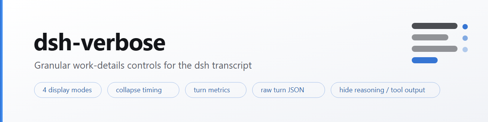
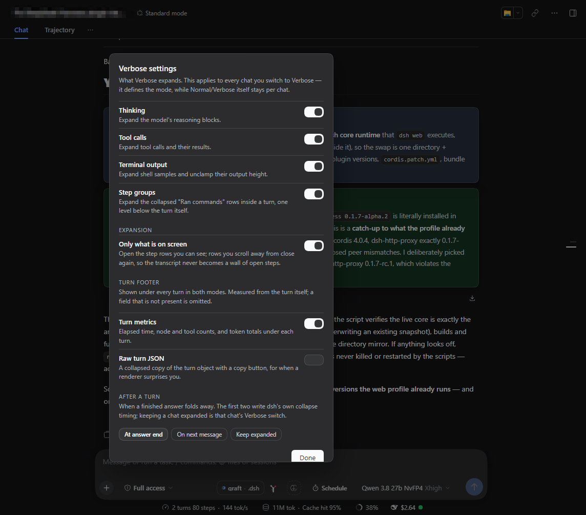

<picture>
  <source media="(prefers-color-scheme: dark)" srcset="assets/banner-dark.png">
  
</picture>

<br>

# dsh-verbose

[English](README.md) | 中文

      

一个 [DeepSeek Harness](https://github.com/deepseek-ai/deepseek-harness) 插件，把对话记录变成按会话阅读的形式：
会话头部的**三点菜单**里，下载会话日志、把**每个会话**单独切换为 Normal 或 Verbose，并定义
**Verbose 展开哪些内容** —— 思考块、工具调用、终端输出。

**一切都在浏览器里。** 两个 `localStorage` 键 —— 一个按会话的开关，一份全局类别设置 —— 没有服务，没有遥测。



它做四件事：

- **按会话的 Normal/Verbose 开关** —— 在三点菜单里，原位替换内置的 Session log 按钮（同一位置、同一 id、
  更低优先级），头部仍然只有一个三点控件。只作用于当前会话，立即生效，按会话保存在 `localStorage`。
- **“Verbose 展开哪些内容”对话框** —— Thinking、Tool calls、Terminal output 三个全局开关，加
  *Turn footer* 分组与 *After a turn* 的折叠方式。改动类别立即重新应用当前会话。
- **展开范围** —— 默认只在步骤行进入视口时展开、滚出后重新折叠，长会话不会堆出一整墙展开的步骤；
  关闭则是原插件"一次性全部展开"的行为。
- **回合信息条** —— 每个回合下方的 `⏱ 12.3s · 47 nodes · 9 tools · 84.2k tokens`，Normal 与 Verbose
  都显示，外加一个可折叠的原始回合 JSON 与复制按钮。

## 为什么需要它

dsh 的对话记录只有一组全局展示参数（`transcriptView`：compact / standard / detailed /
verbose），并没有"按会话选择"的概念。这与实际需求不符：*想看多少过程* 属于某一段对话，
而 *verbose 到底展开什么* 属于你本人。

本插件把两者拆开：

| 作用域 | 设置 | 存放位置 |
|---|---|---|
| 每个会话 | **Normal** 或 **Verbose** | `localStorage`，以 session id 为键 |
| 全局 | Verbose 展开哪些类别：思考、工具调用、终端输出 | `localStorage`，所有会话共用一份 |

两个作用域是刻意的：按会话复制类别设置只会导致漂移；而全局的 Normal/Verbose 会一次性
翻转所有对话。

## 你会看到什么

菜单**替换**内置的 Session log 按钮 —— 同一位置、同一 id、更低优先级 —— 因此头部仍然只有
一个三点控件：

- **Session log** —— 下载当前会话日志（宿主控制器未挂载时回退到导出 URL）。
- **Transcript view → Normal / Verbose** —— 只作用于当前会话，立即生效。
- **Verbose settings…** —— 对话框：三个类别开关、*Turn footer* 分组的 **Turn metrics** 与
  **Raw turn JSON**，以及 *After a turn* 的折叠方式。类别改动立即重新应用当前会话；信息条开关为全局，下一次渲染生效。
- **Compact settings…** —— 仅在挂载了 `context-governor` 时出现（见"兼容性"）。

Normal 保持 dsh 原本的渲染。Verbose 采用 React 之外唯一可行的方式：找到 dsh 已渲染的每个
可展开行（`[data-expandable][aria-expanded]`），分类后点击属于已启用类别的行，并在回答流式
生成、行被重建时持续这么做。定位依据是语义属性，绝不依赖哈希类名：

| 类别 | 管制的行 | 选择器 |
|---|---|---|
| Thinking | 推理块 | `closest('[data-variant="think"]')` |
| Terminal | shell 示例 | `closest('[data-sample="bash"]')` |
| Tool calls | 其余全部 | 默认 |
| Step groups | 回合内嵌套的 "Ran commands" 行 | `[data-process-activity]` |

Thinking 优先判断，因此嵌套在推理块内的工具行归为 thinking —— 外层所属类别正是你关掉的那类。
### 回合信息条（本次移植新增）

dsh 渲染器没有对应开关，因此这两项由本插件在 `conversation.chat.turnTail` 自行渲染：

- **Turn metrics** —— 每个回合下方的 `⏱ 12.3s · 47 nodes · 9 tools · 84.2k tokens`，
  Normal 与 Verbose 都显示。全部来自插槽交出的回合对象；缺失的字段直接省略，绝不补零。
- **Raw turn JSON** —— 同一对象的折叠副本与复制按钮，并限制长度，超大回合不会卡住页面。

它们刻意**不**作为引擎类别：引擎分类的是可展开行，而"metrics 行"并不存在 —— 把它列进类别
只会让引擎去找永远找不到的行。它们与类别同存于 `dsh-verbose.categories`，并通过
`dsh-verbose:prefs` 事件让所有已挂载的信息条与对话框保持同步。
### 展开范围（本次移植新增）

**Only what is on screen** 开关决定 Verbose 花多少力气：

- **开（默认）** —— 步骤行进入视口时展开，滚出视口后重新折叠。以阅读位置为准：长会话不会
  堆出一整墙展开的步骤，滚回去时又会重新展开。
- **关** —— 一次性展开所有已启用类别，即原插件的行为。

三条规则保证该模式稳定，每一条都源于一次真实故障：

1. **两条边界，而非单一阈值。** 行必须明显进入视口（内侧 120px）才展开，明显离开（外侧
   260px）才折叠；两者之间是"什么都不做"的死区。单一阈值时，展开一行会把下一行推出边界 →
   折叠 → 布局回弹 → 又符合条件，形成来回弹跳。
2. **滚动停止后才折叠**（最后一次滚动后 420ms），不会在滚动过程中把内容抽走。
3. **本轮只要点击过，就自我抑制 320ms。** 否则我们自己点击引发的 DOM 变更会立刻安排下一次
   判定，使振荡自我维持，而不是一次性的。

另外两处让动作看起来是"动"而不是"坏"：每轮先记录当前阅读位置的锚点行，操作后按高度差修正
`scrollTop`（否则在你上方展开会把整页顶下去）；每行切换时加 170ms 淡入。切换会话后的第一轮
延迟一帧，因为 dsh 会在同一次提交里恢复该会话的滚动位置。
### 回合结束后的处理（本次移植新增）

第三组决定**已完成回答**的收起方式：

| 选项 | 效果 |
|---|---|
| At answer end | 写入 dsh 自带的 `collapseTiming: completion` |
| On next message | 写入 dsh 自带的 `collapseTiming: next-input` |
| Keep expanded | 把**当前会话**切换为 Verbose —— "永不折叠"是每个会话的开关，而非 dsh 的全局值 |

前两项通过 `ctx.configForms.get("ui-chat")` 写入，与 dsh 自带设置行同一通道，因此内置渲染器
的反应与手动设置完全一致。第三项刻意复用按会话的 Verbose 开关，而不另存一个标志位：
"这个会话是否展开"若有两个真相来源，迟早会不一致，而那种不一致看起来就像其中一个的 bug。

## 安装

```sh
dsh plugin --profile web add dsh-verbose
dsh --profile web
```

本地目录：

```sh
dsh plugin --profile web add link:C:/path/to/dsh-verbose
```

安装后需重启宿主（bundle 行与 governor 桥都在宿主侧）；仅浏览器部分改动时重新加载页面即可。

确认挂载：

```sh
dsh --profile web --dump-config | Select-String "id: verbose"
```

一行正确；零行表示 bundle 行未写入。

## 兼容性

- **dsh 0.2 要求所有 strict codec 提供 `create()`。** 原插件早于该规则，因此 `CG_CODEC`
  增加了 `create: () => CG_CODEC.schema`；缺少它时加载器会拒绝整个客户端插件，而不只是 remote。
- **插槽遮蔽是刻意的。** 注册使用内置条目自己的 id（`session-log-download`）并设置
  `priority: -1`；列表插槽对同一 id 只投影一个条目，优先级低者先投影 —— 这正是"替换按钮"
  而不是"多出一个按钮"的原因。
- **`context-governor` 可选。** 宿主侧把它通过 Typert Remote 重新发布给 Compact 面板。
  未挂载该插件时，桥在 `try` 内失败，各方法返回 `available: false`，菜单自动省略该项。
- **dsh 0.2 对过程行做了分组。** 0.1.5 给每一行都打 `[data-expandable][aria-expanded]`；
  0.2 把一个回合的过程行合并成一个 `button[data-turn-process]`，仅 bash 工具视图仍标记自身
  （`data-variant="bash"`）。因此引擎匹配
  `[data-turn-process][aria-expanded], [data-expandable][aria-expanded]` —— 移植自 0.1.5 的
  选择器在这个版本里**匹配不到任何东西**，表现正是"Verbose 毫无反应"。
  需要知道的限制：折叠状态下组内只有一个按钮，因此单独关闭 Thinking 无法在组关闭时隐藏推理
  —— 组要么展开，要么不展开。
- **存储键**带插件前缀（`dsh-verbose.verbose`、`dsh-verbose.categories`），与原来的
  `session-view-menu` 并存也不会互相污染。

## 常见问题

| 现象 | 原因 | 处理 |
|---|---|---|
| 条目加载失败（`dsh-verbose: failed`） | `apply` 读取了未声明的服务 | 本插件声明 `slots` + `remote`，对照错误文本检查 |
| 出现两个三点按钮 | 另一个插件也遮蔽了 `session-log-download` | 只保留一个，两者 id 相同 |
| Verbose 没有反应 | 当前会话尚无任何可展开行 | 发一条消息，行会随回合出现 |
| 没有 Compact settings | 未挂载 `context-governor` | 属预期，该面板可选 |
| 刷新后设置丢失 | 隐私模式 / 存储被禁用 | 本插件依赖 `localStorage` |

## 开发

```sh
npm test
```

- `tests/client.test.mjs` —— 用 shim 加载真实 bundle，断言决定其能否挂载的两件事：声明的服务、
  插槽遮蔽（名称、内置 id、优先级、registrant）；并渲染一层菜单，确认触发器存在、弹窗默认关闭。
- `tests/classify.test.mjs` —— 引擎分类规格：推理包装层、普通工具行、单元素同时带两个属性的
  bash 行，以及已展开的思考块。

## 许可证

MIT，见 [LICENSE](./LICENSE)。实现改编自 `session-view-menu` 1.1.0（MIT，同一作者），
按 dsh 0.2 的 codec 规则与上述命名空间做了适配。
