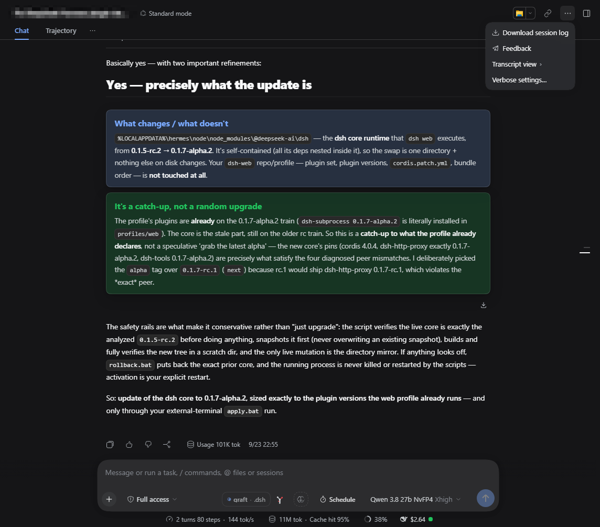
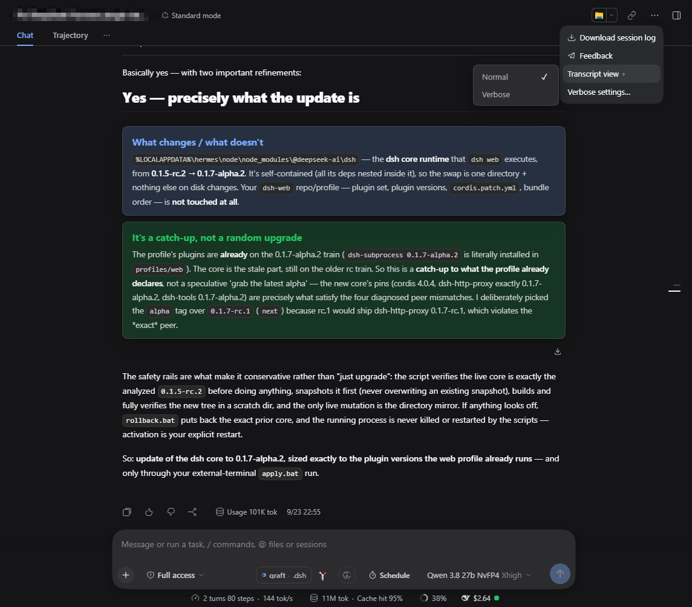

# dsh-verbose

A [DeepSeek Harness](https://github.com/deepseek-ai/deepseek-harness) plugin that gives the transcript a per-chat reading mode, in the shape dsh itself lacks: the session-header **3-dots menu** downloads the session log, switches **each chat** between Normal and Verbose, and defines **what Verbose expands** — thinking blocks, tool calls, terminal output.

[View on GitHub](https://github.com/adithyanraj03/dsh-verbose){: .btn }

      

**Everything stays in the browser.** Two `localStorage` keys — a per-chat switch and a global category set — no service, no telemetry.

---

## Install

```sh
dsh plugin --profile web add dsh-verbose
dsh --profile web
```

Or from GitHub or a local folder instead:

```sh
dsh plugin --profile web add github:adithyanraj03/dsh-verbose
dsh plugin --profile web add /path/to/dsh-verbose
```

Restart the host afterwards — the bundle row and the governor bridge are host-side; the browser half alone is reload-only. The **3-dots menu** in the session header gains the **Transcript view** and **Verbose settings…** rows.

Confirm the row:

```sh
dsh --profile web --dump-config | Select-String "id: verbose"
```

One line is correct; none means the bundle row was not written.

---

## What it does

### A per-chat Normal/Verbose switch

The menu **replaces** the built-in Session-log button — same seat, same id, lower priority — so the header still has exactly one 3-dots control. The switch applies to the open chat immediately and is remembered per session in `localStorage`, keyed by session id.



The tick shows the open chat's current view:



### What Verbose expands

Normal leaves the transcript as dsh renders it. Verbose works the only way available from outside React: it finds every disclosure row dsh already renders, classifies it, and clicks the ones whose category is enabled — then keeps doing so for rows that arrive while an answer streams. The hooks are semantic attributes, never class hashes:

| Category | Row it governs | Selector |
|---|---|---|
| Thinking | reasoning blocks | `closest('[data-variant="think"]')` |
| Terminal | shell samples | `closest('[data-sample="bash"]')` |
| Tool calls | everything else | default |
| Step groups | the nested "Ran commands" rows inside a turn | `[data-process-activity]` |

Thinking is tested first, so a tool row nested inside a reasoning block counts as thinking — the enclosing kind is the one you switched off. Changing a category re-applies the open chat at once.


### Only what is on screen

A switch decides how much work Verbose does. **On** (the default) opens a step row when it enters the viewport and folds it again when it scrolls out, so a long transcript never builds a wall of open steps; **off** opens everything enabled at once, which is what the original plugin did.

Three rules keep the mode stable, and each one exists because of a real failure:

1. **Two bands, not one threshold.** A row must be clearly on screen (120 px inside) before it opens, and clearly gone (260 px outside) before it closes; the gap is a dead zone where the engine does nothing.
2. **Folding waits for the reader to stop** (600 ms after the last scroll). Nothing collapses out from under a scroll in progress.
3. **A pass that clicked anything suppresses itself for 320 ms**, so the mutations our own clicks cause cannot immediately schedule the next decision.

A Verbose chat, with step groups and reasoning opening as the reader scrolls:


### Keyboard focus

dsh's own disclosure rows call `focus()` inside their click handler, which moves the scrollport to the focused element. Two things follow from that: a synthetic click used to park focus on a row (the next Enter re-toggled it instead of sending), and — during a live generation, where every arriving tool call triggers a pass — clicking a row above the reader yanked the transcript up to it.

The fix attacks the cause and then the symptom: for the duration of each programmatic click the row's `focus` is shadowed with a no-op, so focus never moves and nothing scrolls; afterwards any focus that still changed is restored with `preventScroll`.

### A turn footer

Two switches that dsh's renderer has no toggle for, so they are this plugin's own node in `conversation.chat.turnTail`:

- **Turn metrics** — `⏱ 12.3s · 47 nodes · 9 tools · 84.2k tokens` under every turn, in Normal *and* Verbose. Everything is measured from the Turn object the slot hands over; a field that is not present is omitted rather than printed as a zero.
- **Raw turn JSON** — a collapsed copy of that same object with a Copy button, capped so a giant turn cannot freeze the page.

They are deliberately **not** engine categories: the engine classifies disclosure rows, and a "metrics" row does not exist.

### After a turn

The third group decides what happens to a finished answer:

| Choice | Effect |
|---|---|
| At answer end | writes dsh's own `collapseTiming: completion` |
| On next message | writes dsh's own `collapseTiming: next-input` |
| Keep expanded | flips **this chat** to Verbose — "never fold" is the per-chat toggle, not a global value dsh has |

---

## Requirements

- dsh 0.2 (0.2.1-rc.3 tested), with a `web` profile
- Node 22+
- `localStorage` — in private mode, or with storage blocked, the choices reset on reload

---

Licensed MIT. Issues and pull requests at [github.com/adithyanraj03/dsh-verbose](https://github.com/adithyanraj03/dsh-verbose).
